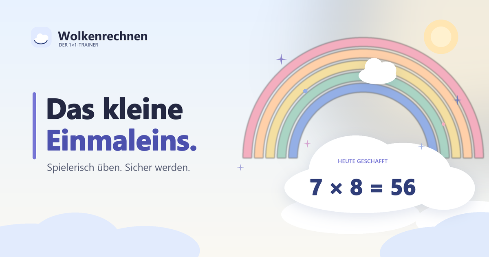

# Wolkenrechnen



A multiplication practice app in German. Choose a session length (5, 10, 15, or 30 minutes) and at least one times table from 1 to 10. Enter each answer and press Enter. On iPads and other touch devices, an on-screen number pad and submit button are available. Correct answers move straight to the next question. A session ends when time runs out or when you select **Beenden** (Finish).

### **[🖩 Practice now](https://joa.github.io/wolkenrechnen/)**

## Run locally

```sh
python3 -m http.server 8000
```

Open [localhost:8000](http://localhost:8000). The app uses native JavaScript modules and CSS and requires no installed JavaScript packages. To build the GitHub Pages artifact in `dist/`, run `node scripts/build.mjs` with Node.js 24.

## Task selection and progress

Each multiplication problem is an arm in a multi-armed bandit. Thompson sampling draws a value from each available problem's Beta distribution to estimate how much practice it needs. Every selected times table appears once before the bandit can choose from all selected tables. Only the first answer attempt contributes to the estimate, and recent observations receive more weight. A small bonus for unsolved problems and excluding the two most recently shown problems encourage variety and help complete a table.

For a correct answer on the first attempt, response time also contributes to the estimate: a solution in 1 second or less counts as fully fluent, a solution taking 10 seconds or more counts as needing practice, and times in between scale linearly. An incorrect first attempt counts as needing practice. The child still receives positive feedback whenever the answer is correct.

Three correct answers in a row and completing an entire times table trigger confetti. The app respects the system setting for reduced motion. At the end of a session, a summary shows observed strengths and problems to practice from that session.

Settings and learning progress are stored in the browser's `localStorage`. An active session stays in memory. The app does not use accounts, trackers, or external resources.

The adaptive task selection was inspired by [KeyZen MAB by Adam Gradzki](https://adamgradzki.com/keyzen-mab/). The sampling approach is based on [A Tutorial on Thompson Sampling](https://web.stanford.edu/~bvr/pubs/TS_Tutorial.pdf).
